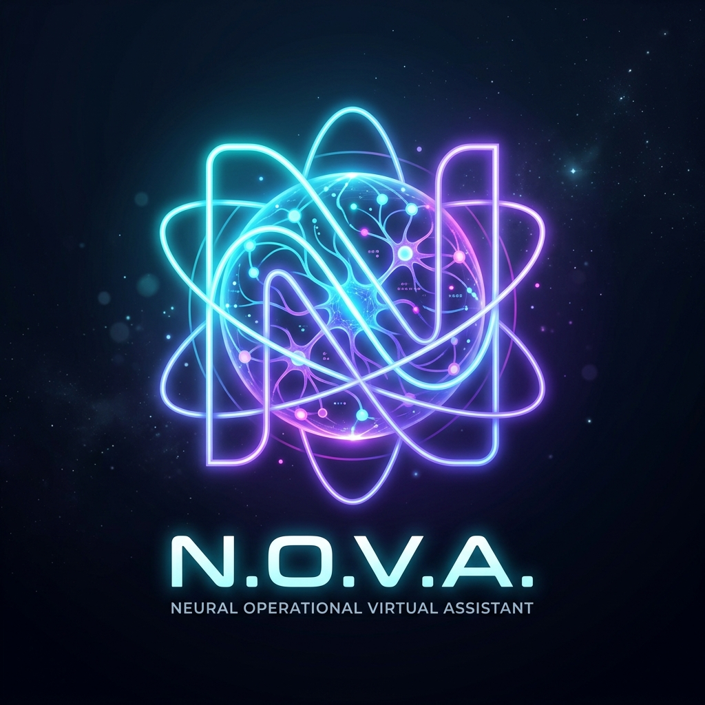

# N.O.V.A. — Neural Operational Virtual Assistant

<p align="center">
  
</p>

> *"Understand → Remember → Reason → Act → Learn → Adapt"*  
> **Architect:** Lead Engineer Aken Sanketh | **Primary Companion:** Anushi Ranshika Peiris  

---

## 🌟 Overview
**N.O.V.A.** (Neural Operational Virtual Assistant) is a futuristic, warm, empathetic, and intelligent AI companion web application designed specifically for **Anushi**. Built with a cutting-edge Cyber Glassmorphism design system, it provides high-performance conversational support, study sprints, and specialized collaboration in **Software Engineering and CyberSecurity**.

---

## ⚡ Core Features

* **🎨 Cyber-Glassmorphism UI/UX**: Glowing holographic visualizer core orb, dynamic mood detection, responsive dashboard, and ambient effects.
* **🧠 5 Cognitive Companion Modes**:
  * `Default`: Balanced companion blending witty banter, empathy, and technical problem-solving.
  * `/vent`: Compassionate active listener providing deep validation with zero unsolicited advice.
  * `/brainstorm`: High-energy creative ideation partner for rapid brainstorming.
  * `/roast`: Sharp, playful banter and humorous teasing between trusted peers.
  * `/focus`: Tactical productivity coach breaking tasks into immediate action steps.
* **🛡️ NOVA AI Memory Vault**: Autonomous multi-sector cloud persistence for:
  * `Profile`: Core identity, birthday (08/09/2008), and specialized fields.
  * `Lore`: Hobbies, inside jokes, active goals, and custom memories.
  * `KnowledgeGraph`: Relational entity triples for reasoning.
  * `Tasks & Reminders`: Student checklists and milestone alerts.
  * `Messages`: Synchronized chat history.
* **⏱️ Focus Sprint Timer**: Pomodoro productivity timer with custom sprint and break intervals.
* **🎙️ Voice & Speech**: Hands-free voice recognition with wake-word detection powered by the Web Speech API.
* **📁 Multimodal Context**: Drag-and-drop file inspector for images, study notes, and code.

---

## 🚀 Getting Started

### Prerequisites
* [Node.js](https://nodejs.org/) (v18+)

### Installation
```bash
# Clone the repository
git clone https://github.com/akensanketh/N.O.V.A.git
cd N.O.V.A

# Install dependencies
npm install

# Start the local development server (Port 2008)
npm run dev
```

Visit the app at `http://localhost:2008/`.

---

## 🛠️ Tech Stack
* **Frontend**: Vanilla HTML5, CSS3, Modern ES2022 JavaScript
* **Build Tool**: Vite
* **AI Engine**: NVIDIA NIM Chat Completions API with reverse-proxy fallback
* **Memory Core**: Standalone Apps Script REST backend
